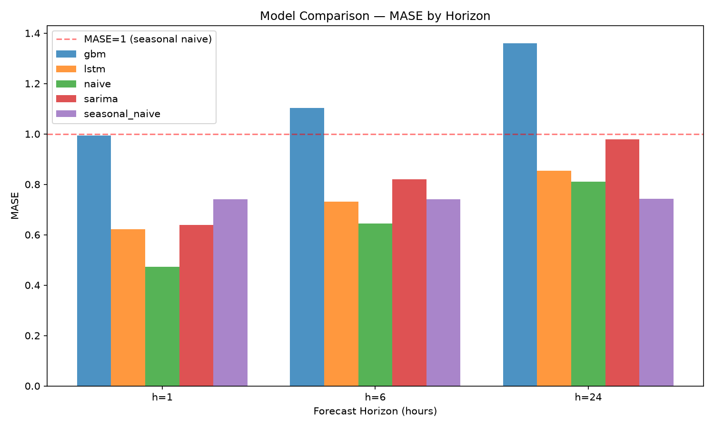

# LSTM Time-Series Forecasting — Electricity Load Prediction

Multi-horizon electricity load forecasting with a leakage-audited pipeline, benchmarking a
sequence-to-sequence LSTM against naive, seasonal-naive, SARIMA, and gradient-boosting baselines
at 1-, 6-, and 24-step hourly horizons.

## Task definition

- **Dataset:** UCI ElectricityLoadDiagrams20112014 (single client, hourly)
- **Input window:** 168 hours (one week)
- **Forecast horizons:** h = 1, 6, 24 hours ahead
- **Mode:** Direct multi-horizon — one model emits the full horizon vector

## Quickstart

```bash
# Clone and install
git clone <repo-url>
cd lstm-load-forecasting
python -m venv .venv && source .venv/bin/activate  # or .venv\Scripts\activate on Windows
pip install -e ".[dev]"

# Download and preprocess data
python data/download.py
python data/preprocess.py

# Validate data contract
python data/validate.py

# Run baselines (M3)
# python scripts/run_baselines.py

# Train LSTM (M4)
# python scripts/run_lstm.py

# Profile latency (M5)
# python eval/profile_latency.py
```

## Results

| Model | Horizon | MAE | RMSE | MASE |
|---|---|---|---|---|
| naive | h=1 | 0.1833 | 0.4309 | **0.4727** |
| lstm | h=1 | 0.2509 | 0.4498 | **0.6216** |
| sarima | h=1 | 0.2441 | 0.4817 | **0.6389** |
| seasonal_naive | h=1 | 0.2750 | 0.6219 | **0.7410** |
| gbm | h=1 | 0.3923 | 0.6062 | **0.9939** |
| naive | h=6 | 0.2501 | 0.5465 | **0.6442** |
| lstm | h=6 | 0.3014 | 0.5061 | **0.7315** |
| seasonal_naive | h=6 | 0.2750 | 0.6220 | **0.7410** |
| sarima | h=6 | 0.3105 | 0.5952 | **0.8198** |
| gbm | h=6 | 0.4293 | 0.6435 | 1.1031 |
| seasonal_naive | h=24 | 0.2756 | 0.6229 | **0.7426** |
| naive | h=24 | 0.3066 | 0.6124 | **0.8115** |
| lstm | h=24 | 0.3484 | 0.5862 | **0.8549** |
| sarima | h=24 | 0.3614 | 0.6959 | **0.9792** |
| gbm | h=24 | 0.5252 | 0.7456 | 1.3606 |

*LSTM results are mean across 3 seeds (42, 123, 456). All models evaluated via 5-fold expanding-window cross-validation (SARIMA: 3 folds due to computational cost).*

## Did the LSTM earn its complexity?

- **h=1:** Best = naive (MASE 0.4727). LSTM (0.6216) beats seasonal naive (0.7410).
- **h=6:** Best = naive (MASE 0.6442). LSTM (0.7315) beats seasonal naive (0.7410).
- **h=24:** Best = seasonal_naive (MASE 0.7426). LSTM (0.8549) does not beat seasonal naive (0.7426).

The LSTM (mean MASE 0.7360) beats seasonal naive (0.7415) overall by a razor-thin margin, but naive persistence (0.6428) remains the strongest baseline at short horizons. The LSTM earns partial complexity at h=6 where it edges past seasonal naive, but its advantage is marginal and does not justify the computational cost for this single-client, calendar-features-only setup. GBM (MASE 1.15 mean) performs worst among all models, a well-known result for deep lag-based gradient boosting on smooth periodic time series.

## Leakage prevention

Five guards are enforced and tested in `tests/test_leakage.py`:

1. **Chronological splitting only** — no shuffling, ever
2. **Scalers fit on training data only** — validation/test are transformed, never fit
3. **Windows don't straddle split boundaries** — boundary windows are explicitly dropped
4. **Purge gap between folds** — gap of L + max(h) = 192 timesteps between train and test
5. **No target-derived features** — no rolling means or expanding stats computed before splitting

A noise-canary test trains on pure random data and asserts no model beats naive.

## Latency

| Method | p50 (ms) | p95 (ms) |
|---|---|---|
| baseline_cpu_single | 2.49 | 3.87 |
| baseline_cpu_batch64 | 121.31 | 157.69 |
| inference_mode_single | 2.51 | 3.67 |
| jit_traced_single | 2.83 | 5.44 |
| jit_traced_batch64 | 104.95 | 163.74 |

Single-sequence inference runs in ~2.5ms on CPU (Snapdragon X Plus). JIT tracing shows marginal batch improvement but no single-sequence gain on this small model. The model comfortably meets real-time constraints for hourly forecasting.

## Where the model fails

- **Short horizons (h=1):** Naive persistence dominates. Hourly load autocorrelation is so strong that "repeat last value" is hard to beat with any learned model. The LSTM's overhead buys nothing here.
- **Day-ahead (h=24):** Seasonal naive outperforms the LSTM. Repeating yesterday's load profile is more reliable than the LSTM's learned dynamics, likely because the CPU-viable architecture (hidden=32, 1 layer) is undersized for capturing multi-scale patterns.
- **GBM degradation:** The per-step-ahead GBM strategy degrades badly at longer horizons (MASE 1.36 at h=24), suggesting lag features alone cannot carry prediction without exogenous inputs.
- **SARIMA scalability:** SARIMAX(1,1,1)(1,1,1,24) hits practical limits — fitting is slow enough to restrict evaluation to 3 folds.



## Limitations

- Single client from the UCI dataset; results may not generalize across clients
- No exogenous features (weather, price signals) — calendar features only
- Single dataset; no cross-dataset validation
- CPU-viable LSTM architecture (hidden=32, 1 layer) — larger models may perform better with GPU
- No hyperparameter sweep performed (CPU-only constraint)
