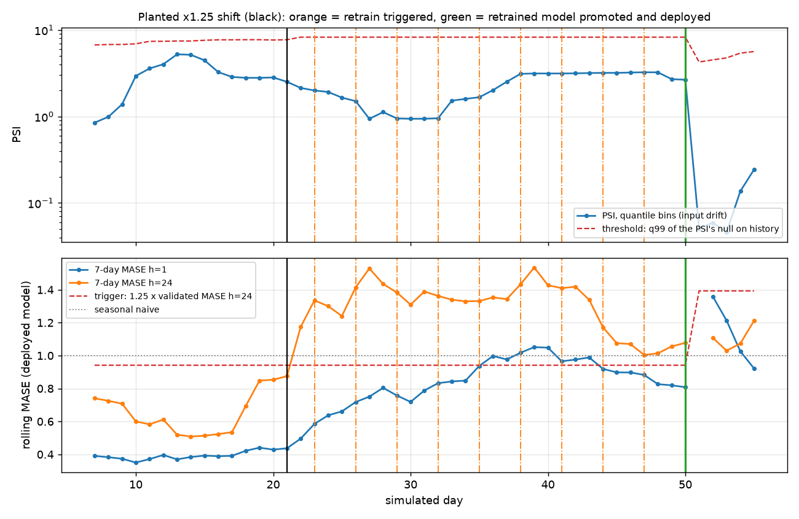

# Results

Everything here is regenerated by commands in the [Makefile](Makefile); the raw
numbers live in [`experiments/results/`](experiments/results). MASE is the headline
metric: the forecast's MAE divided by the in-sample MAE of a 24-hour seasonal-naive
forecast on the training fold (MASE < 1 beats "same hour yesterday").

## 1. Reproducing the original study (M1)

`make train && make evaluate` runs benchmark [`reference`](configs/train/reference.yaml):
the original protocol, refactored into `src/forecast/`, on the original data.

**Data.** The UCI download preprocesses to exactly the published snapshot: 26,305
hourly rows, 2012-01-01 to 2015-01-01, 40,743 zero readings masked, 0 NaN after
cleaning (snapshot `uci_mt001@2026-11-10T184732Z`, content SHA-256 `1a63bb000ecb…`).

**Verdict: PASS — 18 rows bit-exact, 9 documented known differences, 0 failures.**
Full table: [`experiments/results/reference/SUMMARY.md`](experiments/results/reference/SUMMARY.md).

| Published result | Reproduced? | Evidence |
|---|---|---|
| naive, seasonal naive (5 folds) | **exact**: every fold, every horizon | 0.0000 max fold difference |
| SARIMA, `sarima_results.csv` (3 folds) | **exact** | 0.0000 max fold difference |
| GBM, first published (`7f12081`) | **exact** | restored from git history as a second reference |
| GBM, as later published (`efed2b8`) | no: KNOWN | the rows were replaced in a commit that did not change `gbm.py`; the same code produces `7f12081`'s numbers |
| SARIMA, 5-fold rows in `baseline_results.csv` | no: KNOWN | first appear in `efed2b8`; neither committed SARIMA version (30- or 60-day training window) produces them |
| LSTM, 3 seeds | no: KNOWN | see below |

### Why the published LSTM numbers cannot be reproduced

I ran the **original code from history** (`git archive f167b93`) side by side with the
refactored package on identical data: both produce *identical* numbers (seed 42,
fold 0: MASE 1.86004 / 1.92766 / 1.85552). The refactor is faithful; the published
CSV is not reproducible from any committed code:

1. **Mixed configurations.** The seed-42 rows were committed in `f4ec735`, when
   `scripts/run_lstm.py` still built the large config (hidden 128 x 2 layers, batch
   64, up to 100 epochs). Seeds 123 and 456 were appended a commit later, after the
   switch to the CPU config (hidden 32 x 1, batch 256, 30 epochs, patience 5), and
   all nine rows were then averaged as one model.
2. **Neither configuration reproduces the published fold-0 numbers** on this stack
   (large config, seed 42: 0.424 vs published 0.350 at h=1).
3. **The committed CPU config fails on small folds.** Fold 0 has 1,460 training
   windows, i.e. 6 batches per epoch. Validation loss never improves after epoch 1,
   so early stopping ends training at epoch 6 for every seed:

| Fold (train hours) | Reproduced MASE h=1 / 6 / 24 | Published h=1 / 6 / 24 |
|---|---|---|
| 0 (2,016) | 1.921 / 1.890 / 1.873 | 0.373 / 0.496 / 0.546 |
| 1 (10,048) | 1.097 / 1.187 / 1.337 | 0.850 / 0.970 / 1.129 |
| 2 (18,080) | **0.593 / 0.699 / 0.843** | 0.642 / 0.728 / 0.889 |

With enough data (fold 2) the reproduction matches the published numbers, slightly
better. The gap is entirely in the data-starved folds. The production config adds a
`min_epochs` guard against exactly this.

### Methodology problems in the original results table

- **SARIMA was averaged across two fold schemes.** The README's SARIMA row (0.6389
  at h=1) is the mean of 8 rows: 5 from a 5-fold run and 3 from a 3-fold run whose
  folds cover different test periods.
- **The LSTM was scored on 3 folds but compared with baselines scored on 5.**
- **The GBM baseline had a train/serve skew.** At training time its calendar features
  are positions (`t % 24`, `(t // 24) % 7`); at predict time they are the constant
  `168 % 24 = 0`, so every forecast is made as if it were "hour 0 of day 0". Its lags
  were also misaligned by `step - 1` hours (the nominal 24-hour lag at step 24 reads
  `target - 47`). `tests/unit/test_gbm_features.py` now asserts train/serve parity.

Benchmark `aligned` fixes all three (section 2).

## 2. Aligned benchmark: every model on the same 5 folds

`make benchmark` runs [`aligned`](configs/train/aligned.yaml): one 5-fold
expanding-window split for every model, the LSTM over 3 seeds, and the GBM twice
(`gbm_legacy` with the original features, `gbm` with the train/serve skew and lag
misalignment fixed).

Mean MASE over the same 5 folds (lower is better; < 1 beats seasonal naive):

| Model | h=1 | h=6 | h=24 |
|---|---|---|---|
| naive (persistence) | **0.473** | **0.644** | 0.812 |
| seasonal naive (24 h) | 0.741 | 0.741 | **0.743** |
| SARIMA(1,1,1)(1,1,1,24) | 0.697 | 0.887 | 1.116 |
| GBM, original features (`gbm_legacy`) | 0.589 | 0.866 | 1.238 |
| GBM, fixed features (`gbm`) | 0.561 | 0.732 | 0.979 |
| LSTM, 3 seeds (committed CPU config) | 1.028 | 1.086 | 1.190 |

Full per-fold table: [`experiments/results/aligned/SUMMARY.md`](experiments/results/aligned/SUMMARY.md).

- **Fixing the GBM's features helps at every horizon**: MASE falls 5% at h=1,
  16% at h=6 and 21% at h=24, the horizon where the misaligned "24-hour" lag hurt most.
- **Nothing learned beats the naive baselines on this client.** Persistence wins at
  h=1 and h=6 and seasonal naive at h=24. That is the original study's conclusion,
  and it now rests on comparable numbers.
- The fold-to-fold spread is large (std 0.24-0.79). Fold 2 is a hard regime for
  every model, so single-split comparisons of these models would be unreliable.

**The LSTM does not earn its complexity.** Scored like every other model (same 5
folds, 3 seeds, seed spread ±0.08), it is worse than seasonal naive at every
horizon. The original README's verdict ("beats seasonal naive overall by a
razor-thin margin") came from mixing configurations and fold schemes (section 1).
Per fold, 3-seed mean MASE h=1 / h=24, against the best baseline:

| Fold (training hours) | LSTM h=1 | LSTM h=24 | naive h=1 | seasonal naive h=24 |
|---|---|---|---|---|
| 0 (2,016) | 1.854 | 1.809 | **0.317** | **0.324** |
| 1 (6,835) | 0.328 | 0.387 | **0.261** | **0.322** |
| 2 (11,654) | 1.716 | 2.082 | **0.876** | **1.477** |
| 3 (16,473) | 0.534 | **0.826** | **0.419** | 0.884 |
| 4 (21,292) | 0.709 | 0.846 | **0.491** | **0.705** |

The LSTM is competitive only where training data is plentiful and the regime is
stable (folds 1, 3, 4). It beats seasonal naive at h=24 only on fold 3. Fold 0
is the early-stopping failure described in section 1. Fold 2 is a regime change
that hurts every model and the LSTM most.

## 3. Leakage canaries (M1)

`tests/unit/test_noise_canary.py`, run in CI on every PR:

- **Shuffled future-target canary (spec).** A covariate holding `y(t+1)`, permuted in
  time, is fed to the GBM and the LSTM through the real backtest harness: MASE must
  not improve by more than 3% at any horizon. **Positive control:** the *unshuffled*
  covariate is a genuine leak, and the same harness must show at least a 50% gain at
  h=1, proving the negative test has the power to detect leakage.
- **Pure-noise floor.** On i.i.d. noise the best possible MASE is 1/√2 ≈ 0.707 (the
  seasonal-naive denominator is √2 times the mean forecast's MAE). No model, the
  legacy GBM included, may score below 0.657.

The original repository's "noise canary" only checked the autocorrelation of the
random-number generator and never trained a model.

## 4. Model registry and promotion gate (M2)

`tests/unit/test_promotion.py::test_registry_flow_rejects_a_deliberately_worse_model`
runs the full registry loop against a throwaway MLflow store:

| Step | Candidate | Holdout MASE | Production | Decision |
|---|---|---|---|---|
| 1 | v1, deliberately bad (2 units, 1 epoch, lr 1e-5) | 2.61 | none | promoted (first model) |
| 2 | v2, reasonable | 0.64 | v1 (2.61) | **promoted**; v1 becomes `previous` |
| 3 | v3, deliberately bad | 2.61 | v2 (0.64) | **rejected**: "does not beat production" |

Both bundles are scored by the serving code (ONNX Runtime) on the candidate's
holdout window with a shared MASE denominator. Every decision is written to the
version's tags (`promotion.decision`, `promotion.reasons`, `promotion.compared_to`).

## 5. Serving (M3)

- `docker run` serves forecasts: CI builds the image on an arm64 runner (the Lambda
  architecture), starts it and runs the contract tests in `tests/integration/`
  against it.
- HTTP round trip through the container (`POST /forecast`, 168 h in, 24 h out with
  intervals, 500 sequential requests on the Snapdragon X Plus, measured while a
  benchmark was saturating the CPU): **p50 3.2 ms, p95 6.5 ms**.
- PyTorch vs ONNX Runtime CPU latency (`make latency`, raw numbers in
  `experiments/results/latency.csv`). Measured on an idle Snapdragon X Plus (8 cores,
  WSL2 Ubuntu 24.04 aarch64, torch 2.15.0+cpu, onnxruntime 1.31.1) with the
  production architecture (32-unit LSTM, 168x1 input, 24 outputs); 1000 timed runs
  after 100 warm-up runs.

| Runtime | Threads | Batch | p50 (ms) | p95 (ms) | p50 per sequence (ms) |
|---|---|---|---|---|---|
| PyTorch eager, no_grad | 1 | 1 | 1.154 | 1.836 | 1.154 |
| PyTorch eager, no_grad | 8 (default) | 1 | 15.04 | 74.73 | 15.04 |
| PyTorch inference_mode | 1 | 1 | 1.158 | 1.896 | 1.158 |
| ONNX Runtime | 1 | 1 | **0.077** | **0.094** | 0.077 |
| ONNX Runtime | 8 | 1 | 0.078 | 0.096 | 0.078 |
| Serving path end to end (scaling + calendar + ORT + intervals) | 1 | 1 | 0.109 | 0.231 | 0.109 |
| PyTorch eager, no_grad | 1 | 64 | 21.35 | 24.96 | 0.334 |
| PyTorch eager, no_grad | 8 (default) | 64 | 65.13 | 173.19 | 1.018 |
| ONNX Runtime | 1 | 64 | **2.649** | **3.515** | 0.041 |
| ONNX Runtime | 8 | 64 | 2.003 | 8.091 | 0.031 |

ONNX Runtime is about 15x faster than single-threaded PyTorch at batch 1 (0.077 vs
1.15 ms p50) and about 8x faster at batch 64. PyTorch's default 8 intra-op threads
make this small model slower (15 ms p50 and 75 ms p95 at batch 1, where thread
synchronisation dominates), which is why the serving Predictor honours an
`ORT_THREADS` setting (the Lambda deployment in the next PR sets it to 1). The full
serving path adds about 30 microseconds on top of the ONNX call.

## 6. Monitoring and drift (M6)

`make drift-demo` replays eight weeks of the live EIA-930 PJM series (2026-09-16 to
2026-11-10) through the real API container, one simulated day per 1.2 s. The first model
is trained on the first six months of the snapshot. Every simulated day the monitor
scores the last seven days of logged predictions against the actuals. A deployment
needs two consecutive breaches before it triggers a retrain, with at most one retrain
every 72 h, and every retrain goes through the promotion gate. The planted shift
multiplies load by 1.25 from 2026-10-07 (day 21). A control run uses the same code with
a factor of 1.0.

| | Control (no shift) | Planted x1.25 shift |
|---|---|---|
| Daily checks | 49 | 49 |
| Retrains triggered | **0** | 10 (first two days after the shift, then every 72 h while the model stayed worse) |
| First trigger | none | 2026-10-09, two days after the shift |
| Candidates promoted / rejected by the gate | 0 / 0 | 1 / 9 |
| Rolling MASE h=24, before 10-14 | 0.66 | 0.85 |
| Rolling MASE h=24, after 10-14 | 0.59 | 1.26 |
| 80% interval coverage, after 10-14 | 0.84 | 0.55 |

What the run shows, and what it does not:

- **The detector separates the two runs.** With no shift there were no breaches
  and no retrains. With the shift the first trigger came
  two days after it.
- **The trigger was performance, not input drift.** PSI never crossed its threshold in
  either run (peak 5.2 against a calibrated threshold of 4.3 to 8.3). Breaches came from
  rolling MASE h=24 exceeding 1.25 times the validated holdout MASE (0.753). The PSI
  threshold is high because it is the 99th percentile of the PSI at the model's own
  age, and seasonal change between windows already produces large values. A level
  shift of 25% did not stand out from it. PSI is reported but did not carry this demo.
- **Recovery was slow.** The gate rejected the first nine candidates. They were
  trained mostly on pre-shift data, so they did not beat the deployed model on a
  holdout that contains the shifted level. The first model that did was promoted on
  2026-11-05, 29 days after the shift (holdout MASE 0.974 against 0.989 for seasonal
  naive and 1.317 for the deployed model). The gate worked as designed, but a 29-day
  recovery would be too slow for a real service. A level shift this large would call
  for a different remedy, such as a recalibrated scaler or a shorter training window.
- **The demo configs were tuned once on this series.** The first attempt used the
  year-over-year reference, whose PSI threshold cannot be calibrated on two years of
  data, so it sat on its 0.2 floor and retrained eleven days before the shift. The
  shipped demo uses `configs/monitor_demo.yaml` (training-tail reference). The live
  `configs/monitor.yaml` still uses year-over-year and therefore runs on the floor
  threshold until a year of history exists.
- Each run is a single replay of one series, so the timings are one sample, not an
  average.
